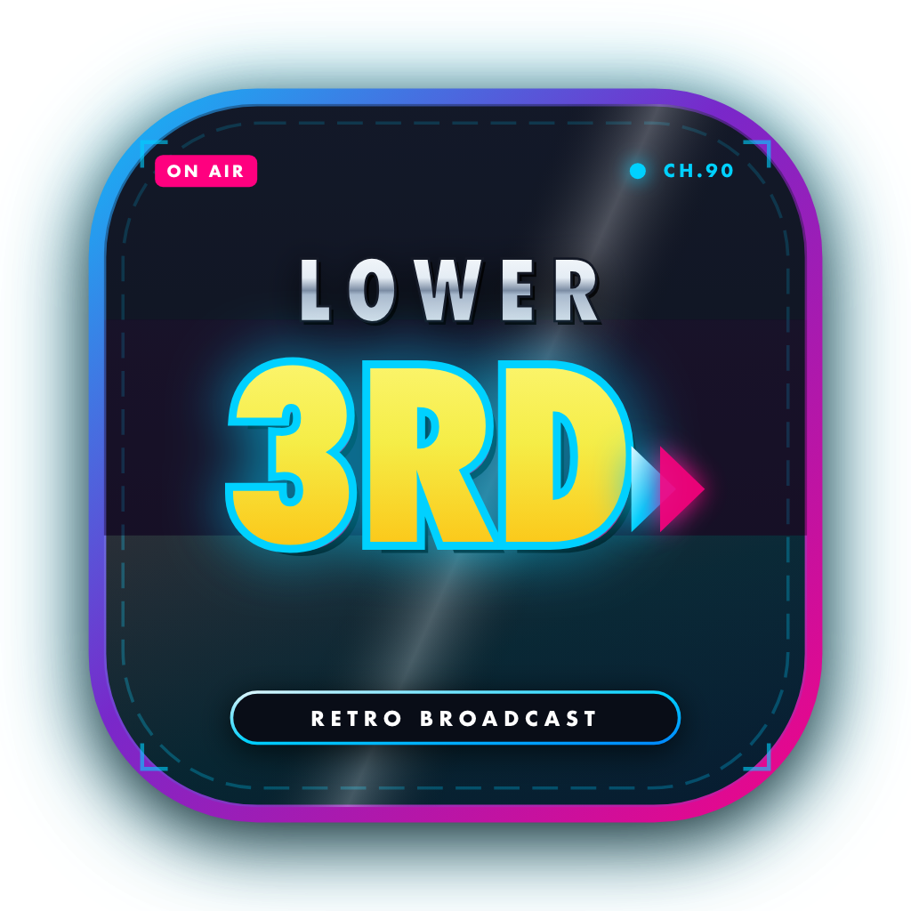
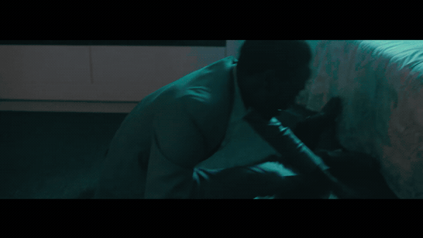
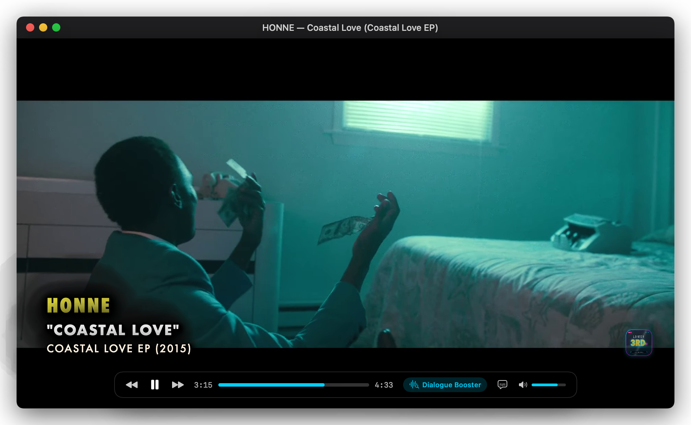
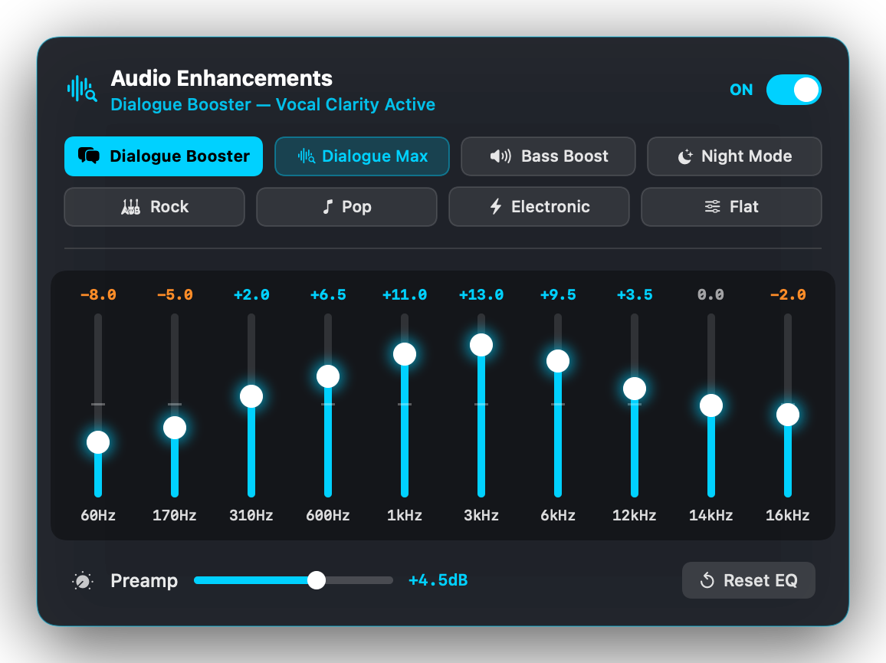

<div align="center">



# Lower3rd

**90s Music-Television Inspired Retro Video Player for macOS**

[](https://apple.com/macos)
[](https://developer.apple.com/xcode/)
[](https://swift.org)
[](https://www.videolan.org/vlc/libvlc.html)
[](https://developer.apple.com/xcode/swiftui/)
[](LICENSE)

*Rediscover the golden era of music television with modern macOS performance.*

</div>

---

> [!NOTE]
> **Trademark & Affiliation Disclaimer:**  
> "MTV", "Music Television", and related names or marks are registered trademarks of Paramount Global / Viacom International Inc. **Lower3rd is an independent, non-commercial open-source project and is NOT affiliated with, sponsored by, endorsed by, or associated with MTV, Paramount Global, or any of their affiliates.** All trademarks, service marks, and trade names referenced in this repository are used strictly for descriptive, historical, and nominative purposes to identify aesthetic inspiration.

---

## 📺 Overview

Remember late-night music video marathons, countdown shows, and the anticipation when a new song dropped? That unmistakable **lower-third graphic bug** would slide onto the screen: the artist's name in bold yellow broadcast typography, the track title quoted in crisp white, and the album/year details beneath it.

**Lower3rd** is a native macOS video player built in SwiftUI and powered directly by the **libvlc** C API. It plays your local video and audio library while recreating that nostalgic, vintage broadcast on-air experience.

---

## 📸 Demo & Screenshots

<div align="center">

### Vintage On-Air Lower-Third Overlay (90s Style)


*Dynamic lower-third bug with smooth animated entrance and exit, Futura broadcast typography, and analog character-generator drop shadows. (Modified excerpt; see Media Attribution below).*

<br/>

### Full Player Experience


*Native macOS windowing with translucent floating transport bar, electric blue progress slider, and dynamic track title.*

<br/>

### 10-Band Studio Equalizer & Dialogue Enhancement


*Integrated 10-band studio graphic equalizer with dedicated pre-amplification and instant acoustic profiles: Dialogue Booster, Dialogue Max, Bass Boost, Night Mode, Rock, Pop, Electronic, and Flat.*

</div>

---

## ✨ Key Features

### 📼 90s-Inspired Broadcast Lower-Third Overlay
- **On-Air Aesthetic:** Styled with classic `Futura-CondensedExtraBold` and `Futura-Bold` typefaces.
- **Retro Color Palette:** Electric broadcast yellow/gold (`#F5ED47`) for the artist with expanded letter tracking; quoted brilliant white for the track title.
- **Analog Character-Generator Shadows:** Layered multi-directional hard outlines and soft drop shadows recreating the look of vintage broadcast titlers.
- **Smart Animation Timeline:** Smooth slide-and-fade entrance on track start, holds for 4 seconds, and gracefully fades out. Does **not** re-trigger on seeks or pauses.
- **Non-Intrusive:** Positioned in the lower-left third with click-through transparency (`allowsHitTesting: false`) so playback controls underneath remain fully interactive.

### 🧠 3-Tier Intelligent Metadata Resolver
Lower3rd seamlessly pulls track information using a priority cascade:
1. **Embedded Container Metadata:** Reads native ID3v2, MP4/iTunes tags, and Vorbis comments directly through `libvlc`.
2. **Sidecar JSON:** Automatically reads `<filename>.json` in the same directory for custom tags:
   ```json
   {
     "artist": "Synthwave Collective",
     "track": "Retrograde Horizon",
     "album": "Neon Nights",
     "year": 1995
   }
   ```
3. **Smart Filename Parser:** Intelligently decodes filenames such as `Artist - Track (Year).mp4`, automatically stripping scene tags (`[1080p]`, `BluRay`, `x264`, `AAC`, etc.).

### ⚡ Direct libvlc Core Playback
- **Universal Codec Coverage:** Interfaces directly with `libvlc` via C bridging to play almost any container or codec without transcoding: `MP4`, `MKV`, `MOV`, `AVI`, `WEBM`, `FLV`, `TS`, `VOB`, `WMV`, `MP3`, `FLAC`, `WAV`, `AAC`, and more.
- **Hardware Acceleration:** Hardware-accelerated decoding via Apple VideoToolbox for efficient playback.

### 🎚 10-Band Graphic Equalizer with Presets
Fine-tune your audio experience with a dedicated 10-band slider equalizer (60Hz to 16kHz) and pre-amplification, featuring tailored acoustic presets:
- 🗣 **Dialogue Booster:** Specially tuned vocal frequency contour (+13dB mid-range boost) to make quiet movie speech crystal clear.
- 💥 **Dialogue Max:** Maximum voice clarity designed to punch through loud background scores and explosion effects.
- 🔊 **Bass Boost:** Deep, punchy low-end enhancement for music videos.
- 🌙 **Night Mode:** Leveling curve that attenuates sudden booms while keeping voices audible.
- 🎸 **Rock**, 🎤 **Pop**, ⚡ **Electronic**, and 🎛 **Flat** studio modes.

### 💬 Multi-Track Audio & Subtitles
- Switch effortlessly between embedded multi-language audio streams and subtitle tracks.
- Drag-and-drop external subtitle files (`.srt`, `.vtt`, `.ass`, `.ssa`, `.sub`) directly onto the player window with instant on-screen HUD confirmation.

### 🖥 Native macOS Experience
- **Auto-Hiding Controls:** Sleek translucent bottom transport toolbar that slides away when the mouse rests.
- **Cursor Auto-Hide:** Mouse cursor hides during uninterrupted playback and reappears instantly upon movement.
- **Full-Screen Support:** Native borderless full-screen (<kbd>⌘</kbd> + <kbd>F</kbd>).
- **Dynamic Window Title:** Shows `Artist — Track (Album)` in the window title bar.
- **Drag-and-Drop:** Drop files or whole folders to instantly queue playlists.

---

## ⌨️ Keyboard Shortcuts

| Shortcut | Action |
|---|---|
| <kbd>Space</kbd> | Play / Pause |
| <kbd>⌘</kbd> + <kbd>O</kbd> | Open Media File(s) |
| <kbd>⌘</kbd> + <kbd>F</kbd> | Toggle Fullscreen |
| <kbd>←</kbd> / <kbd>→</kbd> | Seek Backward / Forward 10 seconds |
| <kbd>↑</kbd> / <kbd>↓</kbd> | Volume Up / Down (5% increments) |
| <kbd>M</kbd> | Toggle Mute |
| <kbd>⌘</kbd> + <kbd>E</kbd> | Toggle Graphic Equalizer Panel |
| <kbd>⌘</kbd> + <kbd>S</kbd> | Subtitle Track Selection Menu |
| <kbd>⌘</kbd> + <kbd>A</kbd> | Audio Track Selection Menu |

---

## 🏗 Architecture

```
┌─────────────────────────────────────────────────────────┐
│                    Lower3rd (macOS)                     │
│                                                         │
│   ┌───────────────────────────┐ ┌────────────────────┐  │
│   │  Lower-Third Overlay View │ │  Transport Toolbar │  │
│   │   (Futura Broadcast Text) │ │  (Auto-hide bottom)│  │
│   └─────────────▲─────────────┘ └─────────┬──────────┘  │
│                 │ TrackMetadata           │ Play/Pause  │
│   ┌─────────────┴─────────────┐           │ Seek/Volume │
│   │     Metadata Resolver     │           │             │
│   │  1. Embedded libvlc Tags  │           │             │
│   │  2. Sidecar .json files   │           │             │
│   │  3. Smart Filename Parser │           │             │
│   └─────────────▲─────────────┘           │             │
│                 │                         │             │
│   ┌─────────────┴─────────────────────────▼──────────┐  │
│   │                 VLCBridge / libvlc               │  │
│   │       - Hardware Decode (VideoToolbox)           │  │
│   │       - 10-Band Graphic Equalizer Filter         │  │
│   │       - Subtitle & Audio Track Demuxing          │  │
│   └──────────────────────────────────────────────────┘  │
└─────────────────────────────────────────────────────────┘
```

---

## 🛠 System Requirements & Building

### Environment & Prerequisites
- **Tested Operating System:** macOS 27.2.1 (Apple Silicon arm64). Compatible with macOS 14.0 (Sonoma) or newer.
- **Development Tooling:** Xcode 27.0 (Build 27A5237l) or Xcode 15/16+.
- **VLC Media Player:** Lower3rd dynamically links against `libvlc` and `libvlccore` provided by the standard macOS VLC installation. Ensure [VLC for Mac](https://www.videolan.org/vlc/) is installed at the standard location:
  ```
  /Applications/VLC.app
  ```

### Build & Run
1. Clone the repository:
   ```bash
   git clone https://github.com/codeNick7/playfull.git
   cd playfull
   ```
2. Open the Xcode project:
   ```bash
   open Lower3rd-MacOS/Lower3rd.xcodeproj
   ```
3. Select the `Lower3rd` scheme and destination `My Mac`.
4. Press <kbd>⌘</kbd> + <kbd>R</kbd> to build and run.

Or compile directly from the command line:
```bash
xcodebuild -project Lower3rd-MacOS/Lower3rd.xcodeproj -scheme Lower3rd -destination 'platform=macOS' build
```

---

## 📜 Credits & Licensing Disclosures

### Demo Media Attribution (Creative Commons)
- **Visual Footage:** Directed by Danilo Parra; cinematography by Kate Arizmendi. Sourced from [Wikimedia Commons](https://commons.wikimedia.org/wiki/File:HONNE_-_COASTAL_LOVE_-_(Official_Music_Video).webm) (originally published on Vimeo) under [Creative Commons Attribution 3.0 Unported (CC BY 3.0)](https://creativecommons.org/licenses/by/3.0/).
- **Music & Sound Recording:** Musical composition and recording *"Coastal Love"* performed by **HONNE** (rights held by HONNE / their respective rights-holders). The CC BY 3.0 license covers the audiovisual work as released by the director/uploader.
- **Adaptation Notice:** The screenshot (`preview.png`) and animated GIF (`lower_third_overlay_demo.gif`) in this repository are **modified excerpts and adaptations** of the aforementioned video, combined with simulated UI overlays and application window chrome for non-commercial software demonstration purposes in accordance with CC BY 3.0 Section 4(b).

### Motion Graphics & Branding
- **App Logo & Splash Media:** The application logo (`assets/logo.png`) and launch intro animation (`intro.mp4`) are programmatically crafted motion graphics created in React using the [Remotion](https://www.remotion.dev) framework, featuring bespoke SVG broadcast vector typography, retro synthesizer chimes, and analog CRT simulation. They are distributed under the project's MIT License.

### Third-Party Libraries & LGPL Compliance
- **libvlc & libvlccore:** Copyright (c) 1998–2026 VideoLAN and authors. Licensed under the [GNU Lesser General Public License, version 2.1 or later (LGPL-2.1+)](https://www.gnu.org/licenses/old-licenses/lgpl-2.1.html).
- **Compliance Details:** This source code repository contains no binary distributions of VLC libraries. Lower3rd links dynamically against `libvlc.dylib` and `libvlccore.dylib` found in the user's local VLC installation. Any distributor packaging a compiled standalone `.app` bundle must comply with LGPL requirements by retaining dynamic linkage (allowing users to replace the shared libraries), including the LGPL text and attribution in the bundle, and providing access to the libvlc source code.

---

## 📄 License

Lower3rd is open-source software released under the [MIT License](LICENSE) by **codeNick7**.
